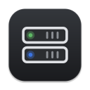
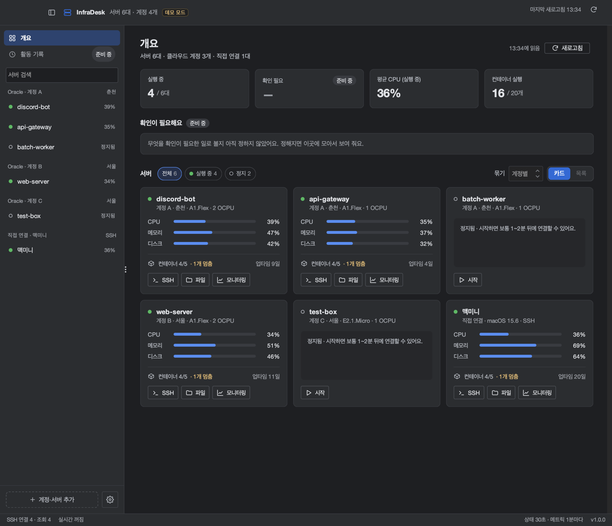
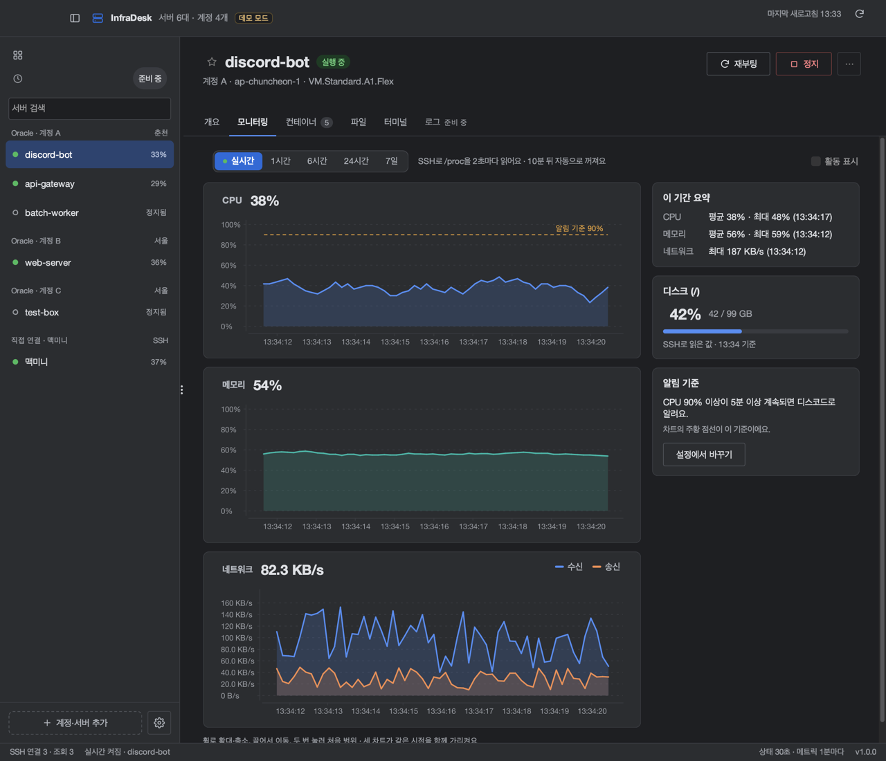
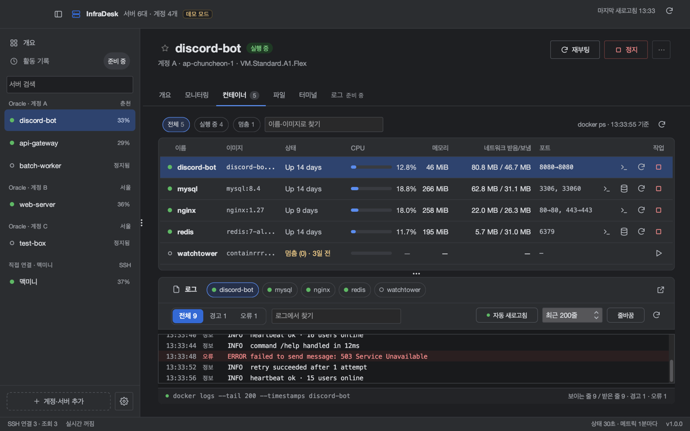
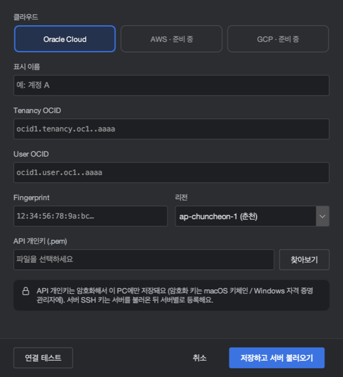

<p align="center">
  
</p>

<h1 align="center">InfraDesk</h1>

<p align="center">
  여러 클라우드 계정의 서버를 한 곳에서 — 상태 모니터링, 전원 제어, SSH 터미널<br>
  macOS · Windows 데스크톱 앱 
</p>

<p align="center">
  <a href="https://github.com/kimdongwoo0930/infra-desk/releases/latest"><b>⬇ 다운로드</b></a> ·
  <a href="#처음-설정">처음 설정</a> ·
  <a href="docs/FEATURES.md">기능</a> ·
  <a href="#데모-모드">데모 모드</a> ·
  <a href="docs/ARCHITECTURE.md">구조</a>
</p>



## 주요 기능

- **계정 여러 개를 한 화면에** — OCI 계정마다 API 키를 등록하면 서버를 자동으로 불러와 계정별로 보여줘요. 맥미니·집 서버 같은 직접 연결 서버도 주소와 SSH 키만으로 함께 관리해요.
- **상태와 제어** — 실행 중 / 정지 상태를 자동으로 새로고침하고, 시작·정지·재부팅은 확인 후 실행해요.
- **모니터링** — CPU·메모리·네트워크 그래프와, SSH로 2초마다 읽는 실시간 모드.
- **SSH 터미널 · SFTP 파일** — 서버별 터미널 탭, 저장된 명령어, 끌어다 놓는 파일 전송과 편집.
- **Docker 컨테이너** — 목록·로그·시작/정지, 컨테이너 안 셸과 DB 콘솔. SSH로만 접근하고 Docker 포트는 열지 않아요.
- **메뉴 막대 아이콘** — 창을 닫아도 서버 상태를 보고 바로 제어할 수 있어요.
- **안전하게** — 키·비밀번호는 암호화해서 이 PC에만 저장하고, 로그에서도 비밀값을 가려요.

| 모니터링 · 실시간 | 컨테이너 |
|---|---|
|  |  |

화면별 설명은 **[기능 안내](docs/FEATURES.md)**에 있어요: [개요](docs/FEATURES.md#개요) · [모니터링](docs/FEATURES.md#모니터링) · [컨테이너](docs/FEATURES.md#컨테이너) · [파일](docs/FEATURES.md#파일) · [터미널](docs/FEATURES.md#터미널) · [설정](docs/FEATURES.md#설정)

> 스크린샷은 모두 [데모 모드](#데모-모드)의 가짜 데이터예요.

## 호환성

✅ 실제 환경에서 확인 · 🟡 지원하지만 아직 실사용 확인 전 · ⏳ 준비 중

**클라우드**

| 클라우드 | 상태 |
|---|---|
| Oracle Cloud (OCI) | ✅ |
| AWS, GCP | ⏳ 준비중 |

**서버 OS** — Ubuntu를 기준으로 제작되었습니다.

| 기능 | 필요한 것 | Ubuntu |
|---|---|---|
| 목록 · 시작/정지 · IP | OCI API만 | ✅ |
| CPU·메모리·네트워크 그래프 | Oracle Cloud Agent (OCI 기본 이미지에 포함) | ✅ | 
| SSH 터미널 | SSH 서버 | ✅ | 
| SFTP | SSH 서버 | ✅ | 
| 서버 정보 · 실시간 모니터링 | Linux `/proc`, `df`, `ss`/`netstat` | ✅ | 
| Docker 컨테이너 | `docker` + docker 그룹 또는 비밀번호 없는 `sudo` | ✅ | 

- **직접 연결 서버(맥미니 등)** ✅: 터미널·SFTP는 그대로 되고, Docker Desktop이나 Homebrew로 설치한 `docker`도 찾아요.
- 서버 쪽 명령은 모두 표준 POSIX 셸로 작성해서 특정 배포판에 의존하지 않아요. 
- OCI 기본 사용자 `ubuntu`(Ubuntu)와 `opc`(Oracle Linux)는 비밀번호 없이 `sudo`가 되므로 Docker도 바로 보여요.
- ARM(Ampere A1)과 x86 인스턴스 모두 같은 방식으로 동작해요.
- SSH 키는 RSA, ed25519 모두 지원해요.

**앱이 실행되는 PC**

| OS | 상태 |
|---|---|
| macOS (Apple Silicon) | ✅ 실행 · 앱 안 업데이트 확인 |
| macOS (Intel) | ⏳ 불가능 |
| Windows 10/11 | ✅ 실행 · 계정 추가 · 앱 안 업데이트 확인 |
| Linux | 소스에서 `./gradlew run` (설치 파일 없음) |

## 다운로드

`main`에 변경이 올라올 때마다 자동으로 빌드되어 새 [릴리스](https://github.com/kimdongwoo0930/infra-desk/releases/latest)(`v1.0.0`, `v1.0.1`, …)로 올라가요. 앱이 새 버전을 알아서 확인하고 메뉴 막대에 알려줘요. 지난 버전은 [릴리스 목록](https://github.com/kimdongwoo0930/infra-desk/releases)에 모두 남아 있어서 이전 버전으로 돌아갈 수 있어요. 아래 다운로드 주소는 버전이 바뀌어도 그대로예요.

| OS | 파일 |
|---|---|
| macOS (Apple Silicon) | [InfraDesk-macOS.dmg](https://github.com/kimdongwoo0930/infra-desk/releases/latest/download/InfraDesk-macOS.dmg) |
| Windows | [InfraDesk-windows.zip](https://github.com/kimdongwoo0930/infra-desk/releases/latest/download/InfraDesk-windows.zip) |


**macOS** — 서명·공증되지 않은 앱이라 처음 한 번 아래 명령이 필요해요.

```bash
xattr -dr com.apple.quarantine /Applications/InfraDesk.app
```

**Windows** — 압축을 풀고 `InfraDesk.exe` 실행. SmartScreen 경고가 뜨면 *추가 정보 → 실행*.

**업데이트** — 설치한 뒤에는 앱 안에서 업데이트해요. *메뉴 막대(트레이) 아이콘 → 새 버전 설치*(또는 설정 → 업데이트·정보 → 업데이트 확인)를 누르면 앱이 새 버전을 직접 받습니다. 받은 파일을 릴리스의 `SHA256SUMS.txt`와 대조하고, 새 버전의 자가 점검(`--self-test`)을 통과하면 앱을 교체해서 다시 열어요. 앱이 직접 받은 파일에는 macOS 격리 표시가 붙지 않아서 `xattr` 명령이 다시 필요 없어요. 실패하면 지금 버전이 그대로 남습니다.

## 처음 설정

### 1. OCI API 키 만들기 (계정마다 한 번)

OCI 콘솔 → 오른쪽 위 프로필 → **내 프로필** → **API 키** → **API 키 추가** → *API 키 쌍 생성* → **개인 키 다운로드** → **추가**.
나오는 *구성 파일 미리보기*의 `tenancy`, `user`, `fingerprint`, `region` 값을 확인해 두세요.

### 2. 계정 추가

사이드바 **⊕ 계정 추가** → 값을 붙여넣고 개인 키(`.pem`) 선택 → **연결 테스트** → **저장하고 서버 불러오기**.
나중에 바꾸려면 계정 이름을 우클릭 → **계정 설정…**.



### 3. SSH 설정 (터미널·실시간·SFTP를 쓰려면)

서버 화면의 **터미널** 탭에서 **접속**을 누르면 SSH 설정 창이 떠요. `~/.ssh/config`에 그 서버(IP)가 있으면 사용자 이름과 키가 미리 채워져요.
처음 접속할 때 호스트 키 지문을 확인하고 신뢰하면, 이후에는 키가 바뀌었을 때만 경고해요.

## 데모 모드

키 없이 가짜 계정·서버로 모든 화면을 둘러볼 수 있어요. 실제 설정·키체인·네트워크는 건드리지 않아요.

```bash
# 설치한 앱
/Applications/InfraDesk.app/Contents/MacOS/InfraDesk --demo
# 소스에서
./gradlew runDemo
```

## 보안과 데이터

| 무엇 | 어디에 |
|---|---|
| 계정 설정(OCID, 리전), SSH 사용자·포트, 저장된 명령어 | macOS `~/Library/Application Support/InfraDesk/`, Windows `%APPDATA%\InfraDesk\` (본인만 읽기) |
| API 개인키, SSH 키, 디스코드 웹훅 | 같은 폴더의 `secrets.vault` — **AES-256-GCM 암호화**. 암호화 키는 OS 키체인(macOS 키체인 / Windows 자격 증명 관리자)에만 |
| 로그 | macOS `~/Library/Logs/InfraDesk/`, Windows `%LOCALAPPDATA%\InfraDesk\logs` — 키·웹훅·공인 IP·OCID는 가려서 기록 |

- 서버 접속은 SSH만 써요. Docker도 SSH로 `docker` 명령을 실행해서 다루고, Docker API 포트(2375)는 쓰지 않아요.
- 처음 보는 서버의 호스트 키는 확인 후 기억하고, 바뀌면 연결을 막아요.
- 공인 IP는 화면에서 기본으로 가려져 있어요(👁 버튼으로 보기).

## 개발

Java 25가 필요해요 (Gradle은 Wrapper 포함).

```bash
./gradlew run            # 실행
./gradlew runDemo        # 데모 모드
./gradlew test           # 테스트
./gradlew snapshot       # 데모 화면을 build/snapshots/*.png로 (창 없이)
./gradlew dmg            # macOS 설치 파일 (패키징된 앱 자가 점검 포함)
./gradlew windowsZip     # Windows (Windows에서)
```

스택: Swing + FlatLaf, Apache MINA SSHD, JediTerm, OCI Java SDK, XChart, jpackage.
문서: [기능](docs/FEATURES.md) · [구조](docs/ARCHITECTURE.md) · [개발 기록](docs/DEVLOG.md) · [디자인](docs/design/DESIGN.md)

## 라이선스

[MIT](LICENSE). 포함된 오픈소스 라이브러리의 라이선스는 앱의 **설정 → 업데이트·정보 → 라이선스 보기**에서 볼 수 있어요.
