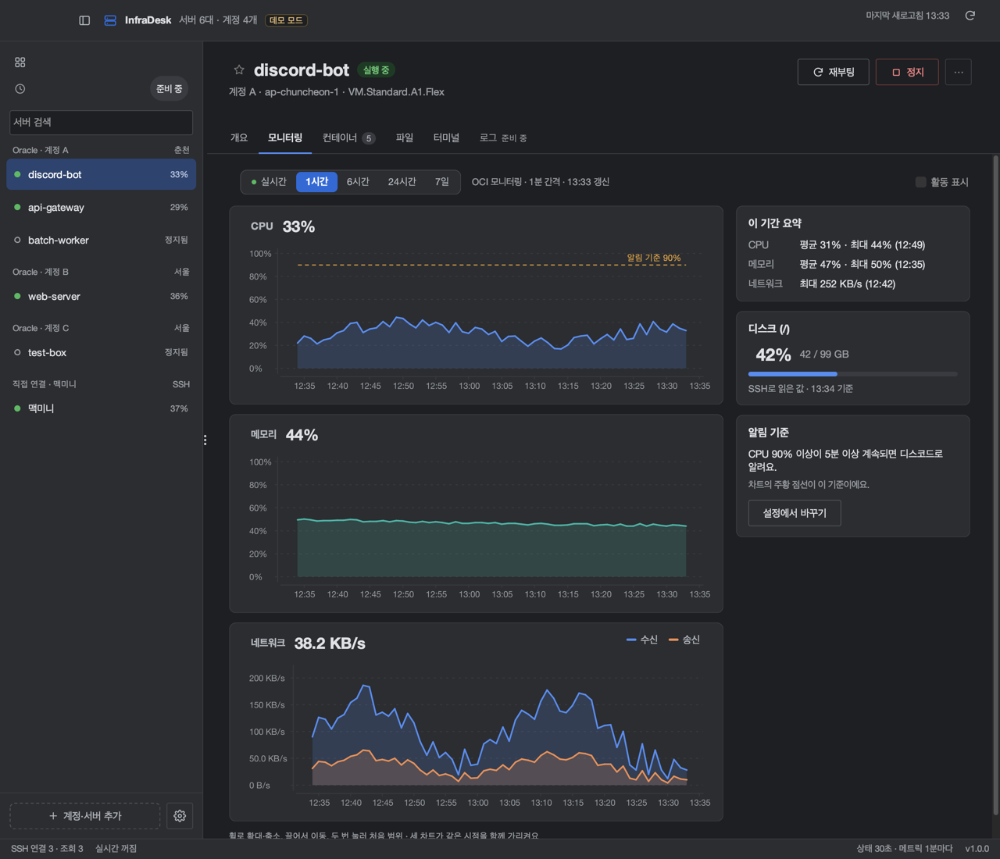
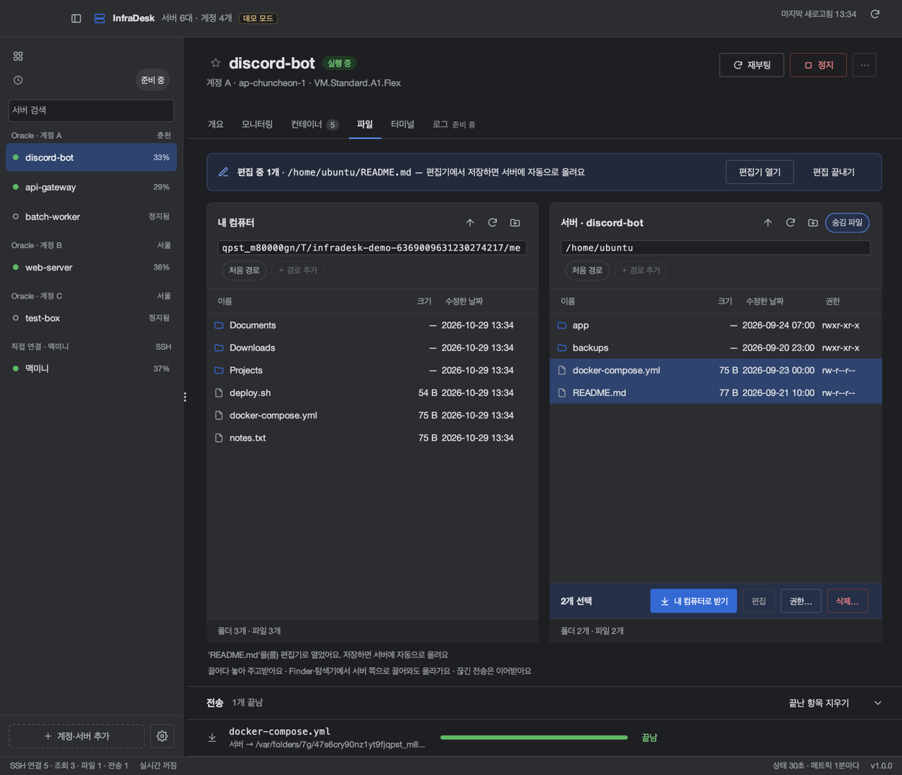
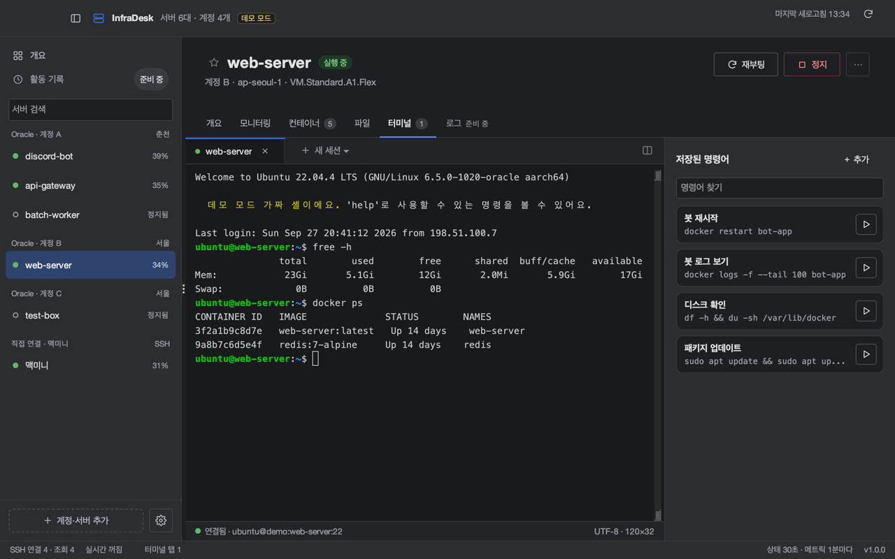
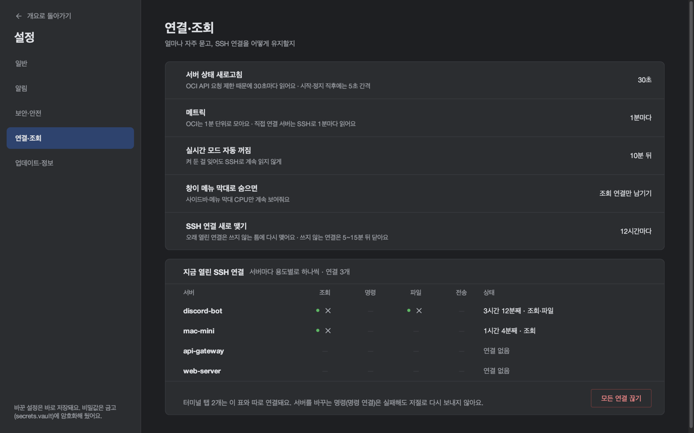

# 기능 안내

InfraDesk의 화면과 기능을 화면별로 설명해요. 설치와 처음 설정은 [README](../README.md)에 있어요.

> 스크린샷은 모두 [데모 모드](../README.md#데모-모드)의 가짜 데이터예요. 실제 서버 정보는 들어 있지 않아요.

| 화면 | 한 줄 요약 |
|---|---|
| [개요](#개요) | 모든 서버를 카드로 한눈에 |
| [서버 정보](#서버-정보) | 서버 하나의 업타임·OS·디스크·열린 포트 |
| [모니터링](#모니터링) | CPU·메모리·네트워크 그래프와 실시간 모드 |
| [컨테이너](#컨테이너) | Docker 컨테이너 목록, 로그, 셸과 DB 콘솔 |
| [파일](#파일) | 내 컴퓨터와 서버 사이 SFTP 파일 관리 |
| [터미널](#터미널) | 서버별 SSH 터미널과 저장된 명령어 |
| [설정](#설정) | 자동 실행, 조회 주기, 업데이트 |
| [메뉴 막대 아이콘](#메뉴-막대-아이콘) | 창을 닫아도 서버 상태 확인 |
| [아직 준비 중인 것](#아직-준비-중인-것) | 화면에 "준비 중"으로 보이는 항목 |

## 개요

앱을 열면 가장 먼저 보이는 화면이에요. 계정과 직접 연결한 서버가 모두 카드 하나씩 나와요.

- 맨 위 네 칸: 실행 중인 서버 수, 평균 CPU, 실행 중인 컨테이너 수.
- 서버 카드: 상태, CPU·메모리·디스크 사용률, 컨테이너 수와 멈춘 수, 업타임. 사용률이 85%를 넘으면 숫자가 경고 색으로 바뀌어요.
- 카드의 **SSH · 파일 · 모니터링** 버튼은 그 서버의 해당 탭으로 이동만 해요. 버튼을 누른다고 바로 접속하지는 않아요.
- 정지된 서버 카드에는 **시작** 버튼이 있어요. 켜지는 데 보통 1~2분 걸려요.
- 위쪽 칩으로 전체 / 실행 중 / 정지 서버만 거를 수 있고, 왼쪽 사이드바에서 계정별로 묶인 서버를 검색할 수 있어요.

## 서버 정보

서버를 고르면 나오는 **개요** 탭이에요. 업타임, OS, 디스크 사용량, 열린 포트를 SSH로 읽어서 보여줘요.

서버 화면 위쪽에는 상태 배지와 **재부팅 · 정지** 버튼이 있어요. 정지와 재부팅은 되돌리기 어려우니 항상 확인 창을 거쳐요. 직접 연결한 서버에는 켜고 끄는 버튼이 없어요.

## 모니터링

CPU, 메모리, 네트워크(수신·송신)를 그래프로 보여줘요.

- 기간: **실시간 · 1시간 · 6시간 · 24시간 · 7일**. OCI 서버는 OCI Monitoring에서 1분 간격으로 읽어요. 직접 연결 서버는 SSH로 1분마다 읽고, 1시간만 볼 수 있어요.
- 그래프 위에서 마우스 휠로 확대·축소, 드래그로 이동, 더블 클릭으로 처음 범위로 돌아가요. 세 그래프는 마우스가 가리키는 시각을 함께 보여줘요.
- 오른쪽에 이 기간의 평균·최대(와 그 시각), 디스크 사용량, CPU 알림 기준이 나와요.

**실시간**을 고르면 SSH로 서버의 `/proc`을 2초마다 읽어서 그려요. 켜 둔 걸 잊어도 SSH를 계속 읽지 않도록 10분 뒤에 저절로 꺼져요.

## 컨테이너

서버에 Docker가 있으면 **컨테이너** 탭에서 다룰 수 있어요. 모든 동작은 SSH로 `docker` 명령을 실행하는 방식이에요. Docker 포트(2375)는 열지 않아요.

- 목록: 이름, 이미지, 상태, CPU, 메모리, 네트워크, 포트. 전체 / 실행 중 / 멈춤으로 거르고 이름·이미지로 찾아요.
- 행마다 컨테이너 안 **셸**, **DB 콘솔**(MySQL · PostgreSQL · Redis · MongoDB), **재시작**, **정지/시작** 버튼이 있어요.
- 아래 로그 패널: 컨테이너를 골라 최근 로그를 보고, 경고·오류만 거르고, 글자로 찾아요. **자동 새로고침**을 켜면 10초마다 다시 읽어요(기본은 꺼짐). 별도 창으로 크게 열 수도 있어요.
- 목록은 계속 읽지 않아요. 서버를 고를 때, 새로고침을 누를 때, 컨테이너를 조작한 뒤에만 읽어요.
- `docker`를 쓰려면 서버에서 docker 그룹이거나 비밀번호 없는 `sudo`가 되어야 해요. 자세한 조건은 [README 호환성](../README.md#호환성)에 있어요.

## 파일

왼쪽 **내 컴퓨터**와 오른쪽 **서버**를 나란히 두고 SFTP로 파일을 옮겨요.

- 파일을 끌어다 놓으면 업로드·다운로드돼요. Finder·탐색기에서 서버 쪽으로 끌어와도 올라가요.
- 끊긴 전송은 이어받아요. 아래 **전송** 목록에서 진행률, 속도, 남은 시간을 보고 취소하거나 다시 시도해요.
- 새 폴더·새 파일, 이름 바꾸기(F2), 권한 변경(읽기·쓰기·실행 체크 또는 숫자 입력), 삭제. 삭제는 확인을 거쳐요.
- 서버 파일을 **편집**하면 내 컴퓨터의 편집기로 열어요. 편집기에서 저장하면 서버에 자동으로 올라가고, 위쪽 배너에서 편집을 끝낼 수 있어요.
- 서버 쪽의 **숨김 파일** 버튼으로 점으로 시작하는 파일을 보이거나 숨겨요.

## 터미널

서버별로 SSH 터미널을 열어요.

- 처음 **접속**을 누르면 사용자 이름과 SSH 키를 정하는 창이 떠요. `~/.ssh/config`에 그 서버가 있으면 값이 미리 채워져요.
- 처음 보는 서버는 호스트 키 지문을 확인하고, 이후에는 키가 바뀌었을 때만 경고해요.
- **＋ 새 세션**에서 서버의 새 셸이나 실행 중인 컨테이너의 셸·DB 콘솔을 열어요.
- 오른쪽 **저장된 명령어**: 자주 쓰는 명령을 카드로 저장해 두고 ▶를 누르면 열려 있는 터미널에 보내요. 우클릭으로 편집·삭제해요.
- 다른 서버로 옮겨도 터미널 세션은 닫히지 않고 숨어 있다가, 돌아오면 그대로 보여요.

## 설정

사이드바 아래 톱니바퀴로 열어요. 바꾼 설정은 바로 저장돼요.

- **일반**: 로그인할 때 자동 실행.
- **연결·조회**: 서버 상태(30초)·메트릭(1분) 조회 주기, 실시간 자동 꺼짐(10분), SSH 연결 새로 맺기(12시간)를 보여줘요. 지금 열려 있는 SSH 연결도 볼 수 있어요. 값은 OCI API 요청 제한을 고려해 정한 것이라 앱에서 바꾸지는 않아요.
- **보안·안전**: 비밀값을 어디에 어떻게 저장하는지(`secrets.vault`, AES-256-GCM, 키는 OS 키체인). 자세한 내용은 [README 보안과 데이터](../README.md#보안과-데이터).
- **업데이트·정보**: 버전, 업데이트 확인, 로그 폴더, 오픈소스 라이선스.

## 메뉴 막대 아이콘

창을 닫아도 앱은 종료되지 않고 메뉴 막대(macOS) / 알림 영역(Windows)에 남아요. 아이콘 메뉴에서 서버 상태를 보고 바로 제어할 수 있고, 새 버전이 나오면 여기에서 알려줘요. 창이 숨어 있는 동안에는 SSH 연결을 조회용 하나만 남겨요.

## 아직 준비 중인 것

화면에 **준비 중** 배지로 보이는 항목이에요. 눌러도 동작하지 않아요.

- 디스코드 알림 (서버 멈춤, 계정 연결 끊김, CPU 고사용)
- 개요의 "확인이 필요해요", 활동 기록, 서버 목록 보기 방식
- 서버 화면의 로그 탭
- AWS, GCP 계정

현재 구현 현황은 [PRD](PRD.md)의 "현재 상태"를 따라요.
